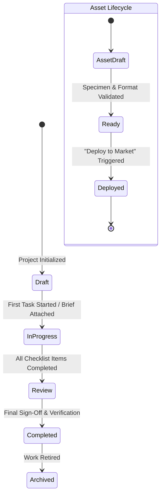

# MOTIF — Creative Workspace & Tool Ecosystem Architecture

> **Status:** Specification & Architecture Blueprint (Batch 01)  
> **Philosophy:** Native Studio Orchestration + External Professional Tool Interoperability  
> **Core Rule:** Do NOT attempt to recreate professional editing software inside MOTIF.  

---

## 1. Workspace Philosophy & The 4-Tier Tool Ecosystem

Creative work is inherently multi-modal. A single brand launch requires vector drawing, editorial layout, copy drafting, short-form video editing, color mastering, and code deployment. Rebuilding Photoshop, Illustrator, Figma, or DaVinci Resolve inside a web browser is an anti-pattern that leads to toy-like, fragile tools.

Instead, MOTIF's Department 02 (CREATE / The Studio) acts as the **Creative Operations Center**:
- **Native Tools** handle conceptual scaffolding, strategy, brief translation, brand guidelines, moodboard reference curation, and asset ledgers.
- **External Professional Tools** handle heavy-duty production (vector design, multi-track timeline editing, broadcast color grading).
- **Import/Export Standards & Deep APIs** synchronize metadata, files, and deliverables back into MOTIF's shared ledger.

```
┌────────────────────────────────────────────────────────────────────────┐
│                        MOTIF STUDIO / CREATE                           │
│                                                                        │
│  ┌──────────────────────────────────────────────────────────────────┐  │
│  │                    TIER 1: NATIVE MOTIF TOOLS                    │  │
│  │  Brief Builder · Brand Planner · Moodboard Studio · Copy Studio  │  │
│  │ Document Studio · Asset Library · Content & Campaign Planners   │  │
│  └──────────────────────────────────▲───────────────────────────────┘  │
│                                     │                                  │
│                 Shared File Interop & Metadata Bridges                 │
│                                     │                                  │
│  ┌──────────────────────────────────▼───────────────────────────────┐  │
│  │                  TIER 3: IMPORT / EXPORT STANDARDS               │  │
│  │     SVG · OTF/TTF · PDF/X · Markdown · Final Cut XML / EDL       │  │
│  └──────────────────────────────────▲───────────────────────────────┘  │
│                                     │                                  │
│                       Bidirectional API & Embeds                       │
│                                     │                                  │
│  ┌──────────────────────────────────▼───────────────────────────────┐  │
│  │             TIER 2 & 4: EXTERNAL TOOLS & DEEP APIS               │  │
│  │      Figma · Canva · Penpot · Photopea · CapCut · DaVinci · Git  │  │
│  └──────────────────────────────────────────────────────────────────┘  │
└────────────────────────────────────────────────────────────────────────┘
```

---

## 2. Tier 1 — Native MOTIF Tools

Native tools are built directly into MOTIF using our high-contrast, editorial design system. They focus on **structure, typography, brand logic, and creative constraints**.

### 2.1 Tool Specifications

| Native Tool | Status | Core Capabilities | Input Types | Output Deliverables |
|---|---|---|---|---|
| **Brief Builder** | **Available** | Practical brief translation, checklist scaffolding, skill requirement mapping, deliverable slot instantiation. | Creative prompt, academy stage prompt, client scope | Structured checklist, `Project` record, deliverable slots |
| **Brand Planner** | **Planned** | Optical type scales, 4-color high-contrast tokenization, voice manifestos, risograph channel pairing. | Palette HEX, font families, positioning statement | `tokens.json`, `BrandGuidelines.pdf`, SVG specimens |
| **Moodboard Studio** | **Planned** | Spatial collage canvas, tactile reference pinning, halftone texture filters, color extraction. | PNG/JPG references, scan uploads, SVG vectors | Moodboard canvas artifact, extracted palette tokens |
| **Content Planner** | **Planned** | Drop release calendar, channel matrix, frequency planning, editorial sprint scheduling. | Campaign goals, deliverable milestones | Release schedule, iCal feed, distribution dispatch |
| **Copy Studio** | **Planned** | Distraction-free Markdown editor, manifesto generator, readability telemetry, typographic quotes audit. | Plain text, Markdown | Formatted copy sheets, manifesto cards, newsletter body |
| **Document Studio** | **Planned** | Brutalist print compiler, 16-page zine imposition layouts, rate cards, client scope agreements. | Markdown copy, asset links, client metadata | Print-ready PDF/X-1a, saddle-stitch imposition sheets |
| **Asset Library** | **Available** | Multi-format asset ledger, version tagging, preview rendering, "Deploy to Market" pipeline. | SVG, PNG, OTF, PDF, MD, MP4 | Verified deliverable records, cross-department handoffs |
| **Campaign Planner** | **Planned** | Channel sequencing, audience segment assignment, asset pairing for multi-channel releases. | Deployed studio assets, channel targets | Active campaign release in Market |

---

## 3. Tier 2 & 4 — External Applications & Deep Integrations

### 3.1 Figma (Tier 2 & 4)
- **Role:** Primary professional interface design, design systems, and vector typography specimen layout.
- **Integration Level:** Deep API + Live Embeds + Plugin.
- **Mechanism:**
  1. **Figma REST API:** Reads file metadata, exports high-res SVG and PNG assets directly into MOTIF `project_assets`.
  2. **Live File Embed:** Renders interactive Figma canvas embeds inside `ProjectDetailPage` using Figma's official embed iframe protocol.
  3. **MOTIF Figma Plugin (Planned):** Pushes brand tokens (colors, font pairings, typographic scales) from MOTIF Brand Planner directly into Figma Variables.

### 3.2 Canva (Tier 2 & 4)
- **Role:** Rapid marketing templates, social banners, pitch decks, and print merchandise.
- **Integration Level:** Deep API (Canva Connect API).
- **Mechanism:**
  1. **Canva Connect REST API:** Authenticates user Canva account via OAuth 2.0.
  2. **Template Autofill:** Sends brand colors, logos, and copy from MOTIF to populate pre-designed Canva design templates.
  3. **Asset Export Webhook:** Exported graphics automatically sync back into MOTIF's studio asset ledger.

### 3.3 Penpot (Tier 2)
- **Role:** Open-source, web-standard vector graphics and prototyping for privacy-conscious independent studios.
- **Integration Level:** External App + Open SVG Standards.
- **Mechanism:**
  - Standard SVG and CSS Grid export/import. Direct project link embedding and shared file backup.

### 3.4 Photopea (Tier 2 & 4)
- **Role:** Browser-based Photoshop-compatible raster editing, risograph texture separations, and halftone pattern masks.
- **Integration Level:** Deep API via HTML5 `postMessage`.
- **Mechanism:**
  - Photopea is embedded directly in an iframe inside MOTIF Studio.
  - MOTIF communicates with Photopea using the official JSON `postMessage` protocol, passing image buffers, executing scripted halftone actions, and retrieving finished PNG/PSD files without external server roundtrips.

### 3.5 CapCut (Tier 2)
- **Role:** Mobile and short-form video editing (Reels, TikTok, YouTube Shorts, release trailers).
- **Integration Level:** External Desktop/Mobile Application.
- **Mechanism:**
  - MOTIF supplies packaged media kits (audio stems, typography title cards, logo bugs) via download zip; user edits in CapCut; exports MP4 deliverable back to MOTIF.

### 3.6 DaVinci Resolve (Tier 2 & 3)
- **Role:** Cinematic release trailers, long-form documentary videos, studio sound design, and broadcast color grading.
- **Integration Level:** Import/Export Interoperability (Tier 3).
- **Mechanism:**
  - **Timeline Exchange:** Exports and imports standard Final Cut Pro XML (`.fcpxml`) and Edit Decision Lists (`.edl`).
  - **LUT Packaging:** MOTIF Brand Planner exports `.cube` 3D LUTs matching brand color palettes for direct ingestion into Resolve color nodes.

### 3.7 GitHub (Tier 2 & 4)
- **Role:** Source code repositories, open-source font specimen documentation, static web publications, and markdown imprints.
- **Integration Level:** Deep API (GitHub REST API & Webhooks).
- **Mechanism:**
  - Creates repositories for published brand systems.
  - Commits typography documentation and web specimens.
  - Triggers automated builds (GitHub Actions) to deploy live project websites.

---

## 4. Tier 3 — Import / Export Interoperability Standards

To guarantee that MOTIF never locks a user's creative assets into a proprietary silo, all tools adhere to universal open interchange formats:

```
  Vector Artwork:     SVG (Scalable Vector Graphics), EPS, AI
  Typography:         OTF (OpenType), TTF (TrueType), WOFF2 (Web Font)
  Editorial & Print:  PDF/X-1a:2001, PDF/X-4 (High-res with CMYK & Spot Inks), IDML
  Writing & Specs:    Markdown (.md), YAML Frontmatter, UTF-8 Text
  Video Interop:      Final Cut Pro XML (.fcpxml), EDL, ProRes 422HQ, MP4 H.264
  Data & Tokens:      JSON (Design Tokens Community Group standard schema)
```

---

## 5. Connecting Learn to Create

### 5.1 The 8-Stage Delivery Chain
The progression from conceptual learning to market delivery is fully defined:

```
┌──────────────┐     ┌───────────┐     ┌────────────┐     ┌─────────────────┐
│Learning Path │────►│  Lesson   │────►│  Exercise  │────►│ Practical Brief │
└──────────────┘     └───────────┘     └────────────┘     └────────┬────────┘
                                                                   │
                                                   Auto-Instantiation (1 Click)
                                                                   │
                                                                   ▼
┌──────────────┐     ┌───────────┐     ┌────────────┐     ┌─────────────────┐
│ Deliverables │◄────│  Assets   │◄────│   Tasks    │◄────│ Create Project  │
└──────┬───────┘     └───────────┘     └────────────┘     └─────────────────┘
       │
       ▼
┌────────────────────────────────────────────────────────┐
│   Deploy to Market  ──► Campaign Roadmaps in Dept 03   │
│   Skill Illumination ──► Competencies Lit in Skill Map │
└────────────────────────────────────────────────────────┘
```

### 5.2 Zero-Manual-Recreation Translation
When a user clicks **"Start in Create"** on a Practical Brief:
1. `progressStore.createProjectFromBrief(briefId)` validates whether a project already exists for that brief.
2. If already created, it navigates directly to the existing project ID, avoiding duplicate records.
3. If new, it instantiates a typed `Project` record:
   - Sets `project.briefId = brief.id`.
   - Copies `brief.title` and `clientOrContext` into project metadata.
   - Instantiates `brief.checklist` as the project's task requirements.
   - Generates initial typed `AssetRecord` placeholder slots matching required deliverables.
4. When the user checks off items in Studio:
   - Changes sync immediately with the brief's checklist in Academy.
   - Once all items are checked, `progressStore` automatically unlocks the associated skills on the Skill Map and marks the project as completed.

---

## 6. Project Lifecycle & Asset Versioning



1. **Asset Creation:** User defines title, type (`identity`, `graphic`, `copy`, `template`, `moodboard`), file format, and preview text.
2. **Asset Validation:** Asset is linked to a valid parent `projectId`.
3. **Deployment Handoff:** Clicking "Deploy to Market" generates an immutable `AssetHandoffRecord` with status `'available'` and timestamp.
4. **Market Ingestion:** Department 03 (Market) queries `getDeployedAssets('market')`, allowing campaign managers to inspect specifications and assign assets to distribution sequences.

