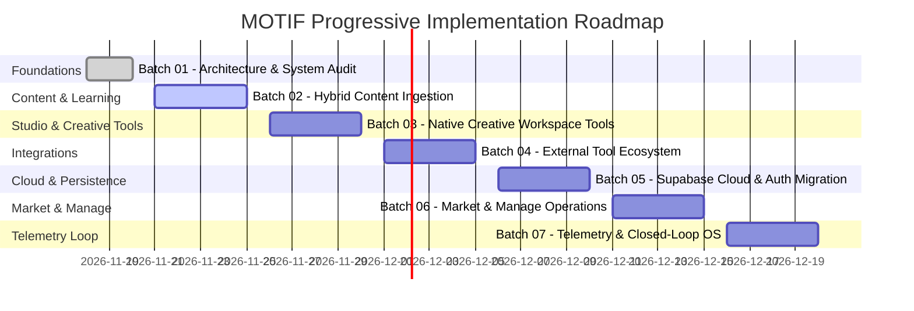

# MOTIF — Engineering Implementation Roadmap & Audit (Batches 01–07)

> **Status:** Implementation Master Plan  
> **Horizon:** 7 Progressive Batches  
> **Architecture:** Offline-First Prototype migrating to Supabase Multi-Tenant Cloud  

---

## 1. System Audit Summary (What Works · What Needs Fixing · What Needs Building)

### 1.1 What Works (Production Ready)
- **AppShell & Responsive Navigation:** `AppShell`, `SideRail`, `TopBar`, `BottomBar`, and `MenuSheet` handle responsive screen sizes down to 375px with accessible focus rings and reduced-motion transitions.
- **Design Token System:** Tailwind CSS v4 with custom CSS variables (`--bg`, `--ink`, `--ox`, `--acid`, `--elec`, `--line`) enforcing the Offscript aesthetic (2px ink borders, hard offset shadows, typographic apostrophes, Bricolage Grotesque + Instrument Sans).
- **LEARN Academy (Original Curriculum):** Full path browsing, lesson previews, brief detail pages, and interactive SVG Skill Map node graph with live illumination.
- **CREATE Studio Project Ledger:** Complete project creation, editing, deletion, search, and status filtering. Brief checklist integration bidirectionally updates Academy and unlocks skills upon 100% completion.
- **Asset Records & Market Handoff:** Typed `AssetRecord` slots in Studio with deduplicated "Deploy to Market" action generating persistent `AssetHandoffRecord` entries and appearing in Market's Incoming Deliverables Tray.
- **Unified Progress Store (`version: 2`):** Idempotent migration from v1, automatic cleanup of legacy keys, cascading project deletion to prevent dangling records.

### 1.2 What Needs Fixing (Technical Debt & Disconnections)
- **Home Dashboard Disconnections:** `HomePage.tsx` tiles (`RecentProjectsTile`, `ContinueLearningTile`, `SkillMapTile`) contain hardcoded mock data arrays rather than reading live state from `useProgress()`.
- **Market & Manage Static Stubs:** Department 03 (`MarketPage`) and Department 04 (`ManagePage`) have static presentation tiles without real creation flows or client CRM databases.
- **Analyze Telemetry Simulation:** `AnalyzePage` displays static metrics; its loopback function (`loopBackToLearn`) is an unlinked stub.
- **Test Automation Integration:** `test_all.ts` passes 100% of its assertions via `npx tsx`, but is not yet wired to `npm test` in `package.json`.

### 1.3 What Needs Building (New Capabilities)
- **Hybrid Content Ingestion Pipeline:** Automated metadata discovery adapters for external providers (HubSpot, Google, Meta, Figma, Canva, OpenLearn, MIT, YouTube) with staging quarantine and verification workflows.
- **Native Studio Creative Tools:** Interactive editors for Brand Planning (token generator), Moodboard Canvas, Copywriting Studio, and Document Compilation (zine imposition sheets).
- **External Tool Integrations:** Figma Embeds and REST API sync, Canva Connect API webhooks, Photopea iframe canvas engine, GitHub repository publishing.
- **Supabase Cloud Backend:** PostgreSQL relational schema, Row-Level Security (RLS) policies, Supabase Auth integration, and private S3-compatible asset storage.

---

## 2. Multi-Batch Implementation Plan



---

## 3. Batch Breakdown & Deliverables

### Batch 01 — Architecture Foundation & System Audit (Current)
- **Objectives:** Inspect existing system; formalize shared architecture; define TypeScript domain models; deliver architecture blueprints.
- **Deliverables:**
  - `src/types/learning.ts`, `creative.ts`, `shared.ts`, `index.ts`.
  - Service boundary foundations: `src/services/content/`, `src/services/integrations/`, `src/services/progress/`, `src/services/projects/`.
  - Documentation: `MOTIF_ARCHITECTURE.md`, `CONTENT_SYSTEM.md`, `CREATIVE_WORKSPACE.md`, `IMPLEMENTATION_ROADMAP.md`.

### Batch 02 — Hybrid Content Registry & Ingestion Pipeline
- **Objectives:** Expand Department 01 into a true Hybrid Academy.
- **Key Tasks:**
  1. Build provider adapter implementations for HubSpot Academy, Figma Learn, and Canva Design School.
  2. Implement unreviewed staging queue UI and editorial review dashboard (`/learn/staging`).
  3. Expand `/learn/library` to filter by provider, pricing (`free` vs `paid`), and difficulty.
  4. Connect `HomePage`'s `ContinueLearningTile` and `SkillMapTile` to real `useProgress()` data.
- **Verification:** Unit tests verifying adapter rate-limiting, URL availability health-checks, and staging quarantine isolation.

### Batch 03 — Native Creative Workspace Tools
- **Objectives:** Implement native creative tools inside Department 02 (The Studio).
- **Key Tasks:**
  1. **Brand Planner:** Palette token builder with WCAG contrast checks, optical font pairing preview, and `tokens.json` export.
  2. **Moodboard Studio:** Spatial canvas with halftone overlay texture filters and drag-and-drop reference pinning.
  3. **Copy Studio:** Distraction-free typographic writing tool with manifesto templates and corporate-jargon linter.
  4. Connect `HomePage`'s `RecentProjectsTile` to live `useProgress().projects`.
- **Verification:** User can generate brand tokens, save moodboard artifacts, and write copy saved directly into `ProjectAsset` records.

### Batch 04 — External Tool Integrations (Figma, Canva, Photopea, GitHub)
- **Objectives:** Connect professional third-party creative software to MOTIF's studio asset ledger.
- **Key Tasks:**
  1. Embed Photopea inside an iframe with two-way `postMessage` script controls for risograph separation and halftone creation.
  2. Add live Figma file viewer embed to `ProjectDetailPage`.
  3. Integrate GitHub release publisher for font specimens and static editorial imprints.
  4. Build import/export handlers for `.svg`, `.otf`, `.pdf`, and `.fcpxml` files.
- **Verification:** Verified bidirectional file transfer: editing an asset in Photopea or Figma and saving the resulting artifact into MOTIF.

### Batch 05 — Supabase Cloud Persistence & Multi-Tenant Auth
- **Objectives:** Migrate from single-browser `localStorage` to PostgreSQL and Supabase Storage without data loss.
- **Key Tasks:**
  1. Execute PostgreSQL schema migrations (Profiles, Skills, Projects, Tasks, Assets, Handoffs).
  2. Enforce Row-Level Security (RLS) policies for user tenant isolation.
  3. Integrate Supabase Auth (Magic Link, Email/Password, OAuth with GitHub/Google).
  4. Implement one-click client-side migration: read `localStorage`, bulk-insert records into Supabase for authenticated user, and clear legacy local store.
  5. Configure private Supabase Storage buckets (`studio-assets`) with signed download URLs.
- **Verification:** User progress, projects, and assets persist across different browsers and devices.

### Batch 06 — Market & Manage Production Workflows
- **Objectives:** Transform Departments 03 & 04 from placeholders into functional business systems.
- **Key Tasks:**
  1. **Market:** Real multi-channel drop sequences (Substack, X, Instagram) grouping deployed studio deliverables into release packages.
  2. **Manage:** Real client accounts, retainer scopes, deliverable sign-offs, and rate-card agreements.
  3. Seamless handoff: Deployed assets assigned to campaigns attach directly to client invoices and contracts in Manage.
- **Verification:** End-to-end trace from brief completion -> studio asset -> campaign package -> client sign-off.

### Batch 07 — Telemetry & Closed-Loop OS Feedback
- **Objectives:** Complete the ecosystem loop from Department 05 (Analyze) back to Department 01 (Learn).
- **Key Tasks:**
  1. Collect campaign telemetry (click-through rates, readership counts, newsletter opens).
  2. Automated insight engine: Identify underperforming channels or creative gaps.
  3. Recommendation trigger: One-click "Loop back to Learn" button enrolls creator in specific curriculum path designed to address observed deficiencies.
- **Verification:** End-to-end simulation of the full 5-department flywheel.

---

## 4. Supabase Migration & Persistence Blueprint

### 4.1 Migration Strategy (Local to Cloud)
To prevent data loss for existing users:
```typescript
export async function migrateLocalStoreToSupabase(supabase: SupabaseClient, userId: string) {
  const localData = progressStore.get();
  if (!localData || localData.projects.length === 0) return;

  // 1. Migrate Projects
  for (const proj of localData.projects) {
    await supabase.from('projects').upsert({
      id: proj.id,
      user_id: userId,
      title: proj.title,
      department: proj.department,
      status: proj.status,
      client_name: proj.clientName,
      brief_id: proj.briefId,
      tags: proj.tags,
      summary: proj.summary,
      updated_at: new Date().toISOString(),
    });
  }

  // 2. Migrate Assets
  for (const asset of localData.assets) {
    await supabase.from('project_assets').upsert({
      id: asset.id,
      project_id: asset.projectId,
      title: asset.title,
      asset_type: asset.type,
      file_format: asset.fileFormat,
      preview_text: asset.previewText,
      description: asset.description,
      status: asset.status,
      updated_at: new Date().toISOString(),
    });
  }

  // 3. Migrate Handoffs
  for (const handoff of localData.handoffs) {
    await supabase.from('asset_handoffs').upsert({
      id: handoff.id,
      asset_id: handoff.assetId,
      project_id: handoff.projectId,
      from_department: handoff.fromDepartment,
      to_department: handoff.toDepartment,
      status: handoff.status,
      deployed_at: handoff.deployedAt,
      notes: handoff.notes,
    });
  }

  // 4. Migrate Skills
  for (const skillId of localData.unlockedSkills) {
    await supabase.from('user_skills').upsert({
      user_id: userId,
      skill_id: skillId,
      proficiency_level: 'mastered',
      confidence_score: 100,
      unlocked_at: new Date().toISOString(),
    });
  }
}
```

### 4.2 Security & Credential Rules
- **No secrets in client bundles:** `VITE_SUPABASE_ANON_KEY` is strictly public; service-role keys are never embedded in the frontend.
- **OAuth Credentials:** Third-party OAuth secrets (Figma, Canva, GitHub) live exclusively in secure Supabase Edge Functions or backend API gateways.
- **Content Security Policy (CSP):** Iframe embedding for Photopea and Figma strictly declares whitelisted frame origins (`https://www.photopea.com`, `https://www.figma.com`).

---

## 5. Quality Standards & Risk Management

| Risk | Impact | Likelihood | Mitigation Strategy |
|---|---|---|---|
| **External Content Drift** (Links 404 or go paywalled) | High | Medium | Automated monthly health-check crons; quarantined staging for unverified links. |
| **Tool Scope Creep** (Attempting to rebuild full design apps) | Critical | High | Strict Tier 1 vs Tier 2 boundaries. Native tools only handle brand tokens, copy, and structure. |
| **Offline Data Desynchronization** | Medium | Medium | Optimistic UI updates with queued write operations and timestamp-based conflict resolution. |
| **Breaking Existing Prototype Aesthetics** | High | Low | Visual regression testing against `docs/design/reference/motif.html`; strict compliance with 2px borders and palette. |
| **Performance Degradation on Large Canvases** | Medium | Low | Virtualized lists for asset vaults; lazy-loaded iframe embeds; code-splitting on routes. |

