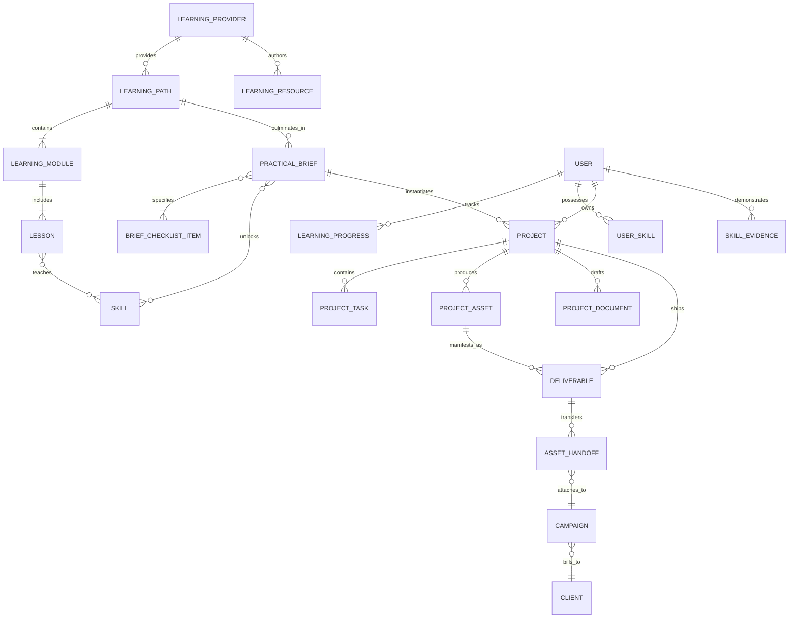

# MOTIF — System Architecture & Shared Foundations

> **Status:** Production Architecture Blueprint (Batch 01)  
> **Tagline:** "Built for the offscript."  
> **Ecosystem:** Interconnected Creative Business & Marketing Operating System  

---

## 1. System Overview & Product Philosophy

MOTIF is an interconnected Operating System for independent creators, designers, agencies, and creative studios. Unlike disconnected toolchains where education lives in one LMS, creative work in a standalone design tool, client contracts in a CRM, and marketing in a social scheduler, MOTIF operates as **one unified workspace across five departments**:

```
        ┌────────────────────────────────────────────────────────┐
        │                 SHARED RECORDS CORE                    │
        │   (Identity · Competencies · Projects · Deliverables)  │
        └───────▲──────────────▲──────────────▲──────────────▲───┘
                │              │              │              │
┌───────────────┴─┐   ┌────────┴────────┐   ┌─┴──────────────┴─┐   ┌─────────────────┐
│     01. LEARN   │──►│   02. CREATE    │──►│    03. MARKET    │──►│   04. MANAGE    │──┐
│  Hybrid Academy │   │ Studio & Tools  │   │ Distribution Hub │   │ Client Systems  │  │
└─────────────────┘   └─────────────────┘   └──────────────────┘   └─────────────────┘  │
        ▲                                                                               │
        │                        05. ANALYZE & GROW                                     │
        └─────────────────────── Closed-Loop Telemetry ◄────────────────────────────────┘
```

### The Closed-Loop Ecosystem
1. **01. LEARN (Hybrid Academy):** Original MOTIF curriculum + curated external learning content across 4 core domains (Branding, Design, Marketing, UI/UX). Practical briefs provide real-world creative challenges.
2. **02. CREATE (The Studio):** The creative workspace. Practical briefs translate directly into active projects without manual re-entry. Native planning tools + external professional application integrations.
3. **03. MARKET (The Hub):** Distribution, release drops, and multi-channel marketing campaigns. Finished deliverables deployed from Create attach directly to campaign roadmaps.
4. **04. MANAGE (The Office):** Client ledgers, retainers, deliverable contracts, scopes, and invoices. Campaigns and deliverables attach directly to client accounts.
5. **05. ANALYZE & GROW (Telemetry):** Readership analytics, campaign engagement, and revenue metrics. Critical insights loop directly back into Learn to recommend targeted curriculum upgrades.

---

## 2. Full Existing System Audit (Batch 01)

### 2.1 Route & Layout Hierarchy
- **Public Routes:**
  - `/`: `LandingPage` (Experimental brand showcase, custom un-authenticated header, interactive ticker, 5-department tabs, shared records preview, offscript typography).
  - `/onboarding`: `OnboardingPage` (Multi-step progressive profiling: Name, Creative Interests, Goals, Workspace Type).
- **Authenticated / AppShell Routes:**
  - Wrapped in `AppShell` with responsive navigation: `SideRail` (desktop 72px), `TopBar` (header with profile, search, dark/light switcher), and `BottomBar` + `MenuSheet` (mobile <768px).
  - `/home`: `HomePage` (Asymmetrical editorial dashboard with dynamic tile configuration: Greeting, Departments Strip, Continue Learning, Deliverable Queue, Recent Projects, Skill Map Preview).
  - `/learn`: `LearnPage` (Curriculum overview, active path resume, suggested next step, compact skill map).
  - `/learn/paths`: `PathsListPage` (Domain filter chips: Branding, Design, Marketing, UI/UX; estimated hours, stages count).
  - `/learn/paths/:id`: `PathDetailPage` (Interactive path viewer: stages, lessons, enrolled state toggle, practical brief trigger).
  - `/learn/briefs/:id`: `BriefDetailPage` (Client context, deadline, creative constraints, deliverable checklist, resource pack, "Start in Create" project generator).
  - `/learn/map`: `SkillMapPage` (Full interactive SVG competency graph, lit illuminated nodes, detailed slide-over drawer).
  - `/learn/library`: `LibraryPage` (Curated specimen, guide, template vault with full search, category tabs, and unified bookmarking).
  - `/create`: `CreatePage` (Studio project ledger, search, status filter chips, New Project modal).
  - `/create/projects/:id`: `ProjectDetailPage` (Project metadata, attached brief checklist, asset slot generator, Deploy to Market pipeline).
  - `/market`: `MarketPage` (Incoming Studio deliverables tray, deliverable inspection modal, campaign tiles).
  - `/manage`: `ManagePage` (Placeholder tile view with client accounts and task ledger).
  - `/analyze`: `AnalyzePage` (Placeholder performance telemetry and loopback insights).
  - `/dev/tokens`, `/dev/components`: Developer design-system inspection tools.

### 2.2 Feature-by-Feature State Inventory

| Department / System | Feature | Status | Verified Implementation | Notes & Technical Debt |
|---|---|---|---|---|
| **Layout & Shell** | Navigation & Responsive Shell | **Working** | `AppShell`, `SideRail`, `TopBar`, `BottomBar`, `MenuSheet` | High contrast, 2px borders, respects reduced motion |
| **Theme & UI** | Tokens & Styling | **Working** | Tailwind CSS v4, CSS variables, `Tile`, `Badge`, `Button`, `Input` | Ivory `#F1EBDD`, Ink `#171717`, Oxblood `#702C35`, Acid `#D9E638` |
| **LEARN** | Paths & Lessons | **Working** | `learnService`, `mockPaths.ts`, `PathDetailPage` | 3 rich multi-stage paths with lesson summaries |
| **LEARN** | Creative Briefs | **Working** | `mockBriefs.ts`, `BriefDetailPage` | 10 creative briefs with constraints and checklists |
| **LEARN** | Skill Map Graph | **Working** | `SkillNodeGraph.tsx`, `SkillDetailDrawer.tsx` | SVG node graph with live lighting of completed skills |
| **LEARN** | Vault / Library | **Working** | `LibraryPage.tsx`, `useResources.ts` | Unified with `progressStore.savedResourceIds` |
| **CREATE** | Project CRUD | **Working** | `createService.ts`, `progressStore.ts` | Full create, read, update, delete with search and filter |
| **CREATE** | Brief-to-Project Pipeline | **Working** | `createProjectFromBrief()`, `BriefDetailPage` | Deduplicated project spawning with attached brief ID |
| **CREATE** | Project Checklist Sync | **Working** | `ProjectChecklist.tsx`, `progressStore.ts` | Scoped by `projectId`; unlocks skills on 100% completion |
| **CREATE** | Studio Asset Slots | **Working** | `ProjectAssetsSection.tsx`, `AssetRecord` | Real asset creation modal and persistent storage |
| **CROSS-DEPT** | Deploy to Market | **Working** | `deployAssetToMarket()`, `IncomingAssetsTray.tsx` | Validates project, creates `AssetHandoffRecord`, prevents dupes |
| **HOME** | Dashboard Tiles | **Partial** | `HomePage.tsx`, `CustomiseTilesModal.tsx` | Preferences work; `RecentProjectsTile` & `ContinueLearningTile` had static stubs |
| **MARKET** | Campaigns & Releases | **Simulated**| `MarketPage.tsx`, `campaigns.ts` | Static cards; incoming deliverable tray is functional |
| **MANAGE** | Client Management | **Simulated**| `ManagePage.tsx`, `clients.ts` | Static mock client records; no real CRUD |
| **ANALYZE** | Telemetry & Insights | **Simulated**| `AnalyzePage.tsx`, `metrics.ts` | Static mock metrics; loopback to Learn is stubbed |
| **BACKEND** | Storage & Auth | **Missing**  | `progressStore.ts` v2 (localStorage) | Supabase is unconfigured; client stubs exist in `src/services/` |

---

## 3. Layered Architectural Boundaries

To avoid competing sources of truth, monolithic spaghetti code, or duplicate service layers, the codebase is structured into five distinct architectural tiers:

```
┌────────────────────────────────────────────────────────┐
│ 1. APP LAYER (Routing, Providers, Root Shell)          │
│    src/app/App.tsx, routes.tsx, providers/             │
└───────────────────────────▲────────────────────────────┘
                            │
┌───────────────────────────┴────────────────────────────┐
│ 2. MODULES LAYER (Department Feature Slices)           │
│    src/modules/{learn, create, market, manage, analyze}│
│    Each with: /pages, /components, /hooks, /services   │
└───────────────────────────▲────────────────────────────┘
                            │
┌───────────────────────────┴────────────────────────────┐
│ 3. CORE DOMAIN SERVICES (Cross-Department Operations)  │
│    src/services/progress, /projects, /content,         │
│    /integrations, /storage, /auth, /api                │
└───────────────────────────▲────────────────────────────┘
                            │
┌───────────────────────────┴────────────────────────────┐
│ 4. REUSABLE UI DESIGN SYSTEM                           │
│    src/components/ui, /layout, /shared                 │
└───────────────────────────▲────────────────────────────┘
                            │
┌───────────────────────────┴────────────────────────────┐
│ 5. SHARED DOMAIN MODELS & CONTRACTS                    │
│    src/types/learning.ts, creative.ts, shared.ts       │
└────────────────────────────────────────────────────────┘
```

### Architectural Guardrails
1. **Modules do not import internal code from other modules.** Cross-department communication occurs strictly via shared domain models (`src/types/`) or core domain services (`src/services/`).
2. **Components never import mock data directly.** All mock, local, or cloud data is fetched through asynchronous service interfaces (`learnService`, `createService`, `contentService`, `integrationsService`).
3. **Storage abstraction:** Components consume reactive React hooks (`useProgress`, `useProject`, `useResources`) which delegate to domain services, decoupling the UI from whether persistence is backed by `localStorage` or `Supabase`.

---

## 4. Cross-Department Data Flow & State Machine

The fundamental differentiator of MOTIF is that work travels from conception to telemetry without manual data re-creation.

```mermaid
sequenceDiagram
    autonumber
    actor User as Creative Professional
    participant Learn as Department 01 (Learn)
    participant Store as Unified Storage (progressStore)
    participant Create as Department 02 (Create)
    participant Market as Department 03 (Market)
    participant Manage as Department 04 (Manage)
    participant Analyze as Department 05 (Analyze)

    User->>Learn: Enrolls in Learning Path & completes Lessons
    Learn->>Store: Persists Enrolment & ProgressItems
    User->>Learn: Opens Practical Brief ("Offscript Identity System")
    User->>Learn: Clicks "Start in Create"
    Learn->>Store: Calls createProjectFromBrief(briefId)
    Store-->>Create: Spawns Project record with briefId & checklist
    Create-->>User: Navigates to /create/projects/:id
    
    loop Studio Execution
        User->>Create: Checks off deliverable requirements
        Create->>Store: Calls toggleChecklistItem(briefId, itemId, projectId)
        User->>Create: Creates Asset Record (SVG Specimen, Type Scale)
        Create->>Store: Calls createAsset(props)
    end

    Note over Store: 100% Checklist completion unlocks Skills on Skill Map
    Store->>Learn: Illuminates competence nodes (Mastered)

    User->>Create: Clicks "Deploy to Market" on finished Asset
    Create->>Store: Calls deployAssetToMarket(assetId)
    Store->>Market: Creates AssetHandoffRecord (status: 'available')
    
    Market->>User: Renders deliverable in Incoming Deliverables Tray
    User->>Market: Inspects deliverable & assigns to Campaign drop
    Market->>Store: Updates handoff status to 'assigned'
    
    User->>Market: Attaches Campaign to Client in Manage
    Store->>Manage: Creates Client Deliverable milestone
    
    Manage->>Analyze: Deliverables & Campaign launch trigger metrics
    Analyze->>Learn: Telemetry insight identifies skill gap; recommends Path
```

---

## 5. Domain Models & Entity Relationships

The domain entities are designed with stable IDs, explicit relational foreign keys, strict typed statuses, ISO 8601 timestamps, and full source attribution.



---

## 6. Service Boundaries & Contracts

### 6.1 `src/services/storage/`
- **`progressStore.ts`:** Single local source of truth for operational state (`version: 2`). Handles atomic CRUD for enrolments, completions, unlocked skills, projects, bookmarks, asset records, and handoffs. Implements idempotent migrations from v1 and legacy keys.
- **`storageService` (`index.ts`):** Handles isolated user preferences: `THEME` ('light' | 'dark' | 'system'), `PROFILE_STORE` (`Profile`), `DASHBOARD_CONFIG` (`DashboardTilesConfig`), and `DASHBOARD_TASKS` (`DashboardTask[]`).

### 6.2 `src/services/content/`
- **Unified Registry:** Coordinates original MOTIF lessons and external learning resources.
- **Provider Adapters:** `ContentProviderAdapter` interface decouples provider ingestion (HubSpot, Google, Canva, Figma, OpenLearn, MIT, YouTube) from catalog display.
- **Dual-State Staging:** Discovered resources land in an unreviewed staging table before editorial review and publication.

### 6.3 `src/services/integrations/`
- **Tool Registry:** 4-tier taxonomy managing Native Tools (Brief Builder, Brand Planner, Asset Library), External Apps (Figma, Canva, Penpot, Photopea, GitHub), File Interoperability, and Deep API Connectors.

### 6.4 `src/services/progress/`
- **Progress Service:** High-level domain facade for path enrolment, checklist tracking, lesson completion, and competency illumination.

### 6.5 `src/services/projects/`
- **Projects Service:** High-level domain facade for project lifecycle, asset slot generation, and cross-department deliverable deployments.

---

## 7. Persistence Architecture & Supabase Migration Path

### 7.1 Database Schema Definition (PostgreSQL)

```sql
-- 1. Profiles & Tenants
CREATE TABLE profiles (
    id UUID PRIMARY KEY REFERENCES auth.users(id) ON DELETE CASCADE,
    name TEXT NOT NULL,
    handle TEXT UNIQUE NOT NULL,
    bio TEXT DEFAULT '',
    interests TEXT[] DEFAULT '{}',
    goals TEXT[] DEFAULT '{}',
    workspace_types TEXT[] DEFAULT '{}',
    avatar_url TEXT,
    created_at TIMESTAMPTZ DEFAULT NOW(),
    updated_at TIMESTAMPTZ DEFAULT NOW()
);

-- 2. Competencies & Skills
CREATE TABLE skills (
    id TEXT PRIMARY KEY,
    name TEXT NOT NULL,
    domain TEXT NOT NULL,
    level TEXT NOT NULL CHECK (level IN ('foundation', 'intermediate', 'advanced', 'offscript')),
    parent_id TEXT REFERENCES skills(id) ON DELETE SET NULL,
    description TEXT NOT NULL,
    criteria TEXT[] DEFAULT '{}',
    created_at TIMESTAMPTZ DEFAULT NOW()
);

CREATE TABLE user_skills (
    id UUID PRIMARY KEY DEFAULT gen_random_uuid(),
    user_id UUID NOT NULL REFERENCES profiles(id) ON DELETE CASCADE,
    skill_id TEXT NOT NULL REFERENCES skills(id) ON DELETE CASCADE,
    proficiency_level TEXT NOT NULL CHECK (proficiency_level IN ('unlocked', 'practicing', 'proficient', 'mastered')),
    confidence_score INTEGER DEFAULT 0 CHECK (confidence_score BETWEEN 0 AND 100),
    unlocked_at TIMESTAMPTZ DEFAULT NOW(),
    last_demonstrated_at TIMESTAMPTZ,
    UNIQUE(user_id, skill_id)
);

-- 3. Learning Paths & Practical Briefs
CREATE TABLE learning_paths (
    id TEXT PRIMARY KEY,
    slug TEXT UNIQUE NOT NULL,
    title TEXT NOT NULL,
    subtitle TEXT NOT NULL,
    domain TEXT NOT NULL,
    level TEXT NOT NULL,
    estimated_hours NUMERIC(4,1) NOT NULL,
    provider_id TEXT NOT NULL,
    description TEXT NOT NULL,
    status TEXT DEFAULT 'published' CHECK (status IN ('draft', 'published', 'archived')),
    created_at TIMESTAMPTZ DEFAULT NOW()
);

CREATE TABLE practical_briefs (
    id TEXT PRIMARY KEY,
    path_id TEXT REFERENCES learning_paths(id) ON DELETE SET NULL,
    title TEXT NOT NULL,
    client_or_context TEXT NOT NULL,
    deadline_notice TEXT NOT NULL,
    description TEXT NOT NULL,
    constraints TEXT[] DEFAULT '{}',
    skills_unlocked TEXT[] DEFAULT '{}',
    handoff_department TEXT DEFAULT 'create',
    created_at TIMESTAMPTZ DEFAULT NOW()
);

-- 4. Projects & Tasks
CREATE TABLE projects (
    id UUID PRIMARY KEY DEFAULT gen_random_uuid(),
    user_id UUID NOT NULL REFERENCES profiles(id) ON DELETE CASCADE,
    title TEXT NOT NULL,
    department TEXT NOT NULL DEFAULT 'create',
    status TEXT NOT NULL CHECK (status IN ('draft', 'in_progress', 'review', 'completed', 'archived')),
    client_name TEXT DEFAULT 'Independent Studio',
    brief_id TEXT REFERENCES practical_briefs(id) ON DELETE SET NULL,
    source_brief_type TEXT DEFAULT 'practical_brief',
    tags TEXT[] DEFAULT '{}',
    summary TEXT DEFAULT '',
    created_at TIMESTAMPTZ DEFAULT NOW(),
    updated_at TIMESTAMPTZ DEFAULT NOW()
);

CREATE TABLE project_checklist_items (
    id UUID PRIMARY KEY DEFAULT gen_random_uuid(),
    project_id UUID NOT NULL REFERENCES projects(id) ON DELETE CASCADE,
    brief_item_id TEXT NOT NULL,
    item_text TEXT NOT NULL,
    completed BOOLEAN DEFAULT FALSE,
    completed_at TIMESTAMPTZ,
    UNIQUE(project_id, brief_item_id)
);

-- 5. Studio Assets & Deliverable Handoffs
CREATE TABLE project_assets (
    id UUID PRIMARY KEY DEFAULT gen_random_uuid(),
    project_id UUID NOT NULL REFERENCES projects(id) ON DELETE CASCADE,
    title TEXT NOT NULL,
    asset_type TEXT NOT NULL CHECK (asset_type IN ('identity', 'graphic', 'copy', 'template', 'moodboard', 'document', 'video', 'code')),
    file_format TEXT NOT NULL,
    storage_path TEXT,
    preview_text TEXT,
    description TEXT,
    status TEXT NOT NULL DEFAULT 'ready' CHECK (status IN ('draft', 'ready', 'deployed', 'archived')),
    version INTEGER DEFAULT 1,
    created_at TIMESTAMPTZ DEFAULT NOW(),
    updated_at TIMESTAMPTZ DEFAULT NOW()
);

CREATE TABLE asset_handoffs (
    id UUID PRIMARY KEY DEFAULT gen_random_uuid(),
    asset_id UUID NOT NULL REFERENCES project_assets(id) ON DELETE CASCADE,
    project_id UUID NOT NULL REFERENCES projects(id) ON DELETE CASCADE,
    from_department TEXT NOT NULL DEFAULT 'create',
    to_department TEXT NOT NULL DEFAULT 'market',
    status TEXT NOT NULL DEFAULT 'available' CHECK (status IN ('available', 'assigned', 'archived')),
    deployed_at TIMESTAMPTZ DEFAULT NOW(),
    notes TEXT
);
```

### 7.2 Row-Level Security (RLS) Policies
- All user-owned tables (`projects`, `project_assets`, `asset_handoffs`, `user_skills`, `project_checklist_items`) enforce strict RLS:
  ```sql
  ALTER TABLE projects ENABLE ROW LEVEL SECURITY;
  CREATE POLICY "Users can only view and manage their own projects"
  ON projects FOR ALL
  USING (auth.uid() = user_id)
  WITH CHECK (auth.uid() = user_id);
  ```
- Public curriculum and competency tables (`learning_paths`, `skills`, `practical_briefs`, `learning_resources`) are read-only for authenticated and anonymous users:
  ```sql
  ALTER TABLE learning_paths ENABLE ROW LEVEL SECURITY;
  CREATE POLICY "Public read access for verified curriculum"
  ON learning_paths FOR SELECT
  USING (status = 'published');
  ```

### 7.3 Supabase Storage Buckets
1. `studio-assets`: Private bucket for project artifacts, typography packages, zine imposition PDFs, and vector masters. Accessible strictly by project owners via signed URLs.
2. `library-vault`: Public read bucket for curated specimens, templates, and reference assets.
3. `profile-avatars`: Public read bucket with user-write policy for studio logos and avatar images.

---

## 8. Summary & Next Steps

This architecture locks the shared structural boundaries across all five departments. The operational data flow is established, tested, and backward-compatible. Batches 02 through 07 will build upon this foundation to expand the hybrid content catalog, native creative editors, external tool integrations, and cloud persistence.

