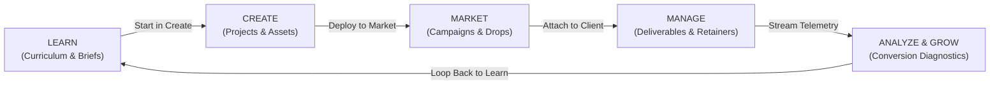

# MOTIF — Product Quality & Scalability Architecture

## Overview
MOTIF is an interconnected Creative Business & Marketing Operating System structured across five core departments:
1. **LEARN (The Academy)**: Competency progression, guided curriculum paths, practical briefs, and an illuminating Skill Map.
2. **CREATE (The Studio)**: Hands-on creative workspace, asset artifact generation, and cross-department deployment handoffs.
3. **MARKET (The Hub)**: Multi-channel broadcast distribution, 14-day drop cadence orchestration, and client campaign attachment.
4. **MANAGE (The Workspace)**: Systematic client roster accounts, deliverable tracking Kanban boards, and retainer MRR ledgers.
5. **ANALYZE & GROW (The Feedback Engine)**: Live performance telemetry, margin diagnostics, and closed-loop learning recommendations that route back into Learn.

---

## 1. Architectural Separation of Concerns

```
┌────────────────────────────────────────────────────────┐
│                        UI LAYER                        │
│    (Brutalist Design System: Pages, Modals, Tables)    │
└───────────────────────────▲────────────────────────────┘
                            │ reactive state
┌───────────────────────────┴────────────────────────────┐
│                    REACT HOOK LAYER                    │
│   (useProgress, useProjects, usePath, useBrief, etc.)  │
└───────────────────────────▲────────────────────────────┘
                            │ business transactions
┌───────────────────────────┴────────────────────────────┐
│                  SERVICE & STORE LAYER                 │
│ (progressStore [v3], learnService, storageService,     │
│  Content Discovery, Integration Services)              │
└───────────────────────────▲────────────────────────────┘
                            │ storage adapters
┌───────────────────────────┴────────────────────────────┐
│                   PERSISTENCE LAYER                    │
│  Current: LocalStorage (Schema Migrated v1 -> v2 -> v3)│
│  Target: Supabase Postgres (RLS, Multi-tenant schemas) │
└────────────────────────────────────────────────────────┘
```

### Architectural Principles Enforced:
1. **Single Source of Truth**: `progressStore.ts` manages all operational progress, entity relations (Projects, Assets, Handoffs, Clients, Campaigns, Deliverables), and state transitions. UI preference items (theme, dashboard tile visibility) remain isolated in `storageService`.
2. **Predictable Data Migration**: Store versions are strictly tracked. Version 3 cleanly migrates from v1/v2 without data resurrection (e.g. explicitly deleted project lists `[]` are preserved).
3. **Strict Zero-Loss Cascading Integrity**:
   - Deleting a project cascades to delete its child assets, handoffs, and linked deliverables.
   - Deleting an asset removes active deployment handoffs.
   - Attaching a campaign to a client automatically creates a corresponding deliverable in Manage and synchronizes client project counts.
4. **Real Operational Workflows**: Every button and control triggers persistent business logic. Fake simulated buttons or dead links have been replaced with full CRUD workflows, input validation, and user feedback.

---

## 2. Cross-Department Closed-Loop Lifecycle



### Traceability of the 5 Closed-Loop Journeys:
1. **Learn -> Create**:
   - Starting a brief in Learn (`BriefDetailPage`) checks for existing project records to prevent duplicate instances (`createProjectFromBrief`).
   - Project checklist ticks are project-scoped and brief-scoped. Ticking all requirements unlocks target skills on the interactive Skill Map and marks the project complete.
2. **Create -> Market**:
   - Studio assets (`AssetRecord`) can be deployed to Market via `deployAssetToMarket`.
   - Generates an immutable `AssetHandoffRecord` ensuring asset integrity across department boundaries.
3. **Market -> Manage**:
   - Market dispatches can be scheduled with target reach, channels, and dates via `NewCampaignModal`.
   - "Attach to Client" binds the campaign to an active client account and automatically spawns a contracted deliverable in Manage.
4. **Manage Operations**:
   - The Deliverables Board allows stage cycling (`Queued` -> `Doing` -> `In Review` -> `Done`), immediately updating client active project counts and persisting state.
   - Client accounts can be registered with MRR scopes, validated contact emails, and status toggles.
5. **Analyze -> Learn**:
   - Telemetry computes actual system reach, retainer MRR, delivery velocity, and skills mapped.
   - Conversion bottlenecks trigger "Loop Back to Learn", navigating directly to `/learn/paths/:id?from=analyze&reason=...` where a dedicated closed-loop banner offers 1-click enrolment.

---

## 3. Database Schema & Migration Compatibility for Supabase

The TypeScript domain models in `src/types/` map 1:1 to target Postgres tables:

| LocalStore Entity | Target Postgres Table | Foreign Keys / Constraints |
| :--- | :--- | :--- |
| `projects` | `projects` | `user_id -> auth.users(id)` |
| `assets` | `project_assets` | `project_id -> projects(id) ON DELETE CASCADE` |
| `handoffs` | `asset_handoffs` | `asset_id -> project_assets(id) ON DELETE CASCADE` |
| `clients` | `client_accounts` | `user_id -> auth.users(id)` |
| `campaigns` | `market_campaigns` | `client_id -> client_accounts(id) ON DELETE SET NULL` |
| `deliverables` | `client_deliverables` | `client_id -> client_accounts(id) ON DELETE CASCADE` |
| `enrolments` | `user_enrolments` | `user_id -> auth.users(id)` |
| `unlockedSkills` | `user_skill_masteries` | `user_id -> auth.users(id)` |

---

## 4. Verification & Automated Test Coverage

The system is continuously verified via comprehensive automated test scripts:
- `tests/test_all.ts`: 14 assertions testing project deletion persistence, deduplication, checklist state rollbacks, version 3 migration, asset deployments, client CRUD, and campaign attachments.
- `tests/test_ui_consistency.ts`: 13 assertions verifying all page exports, component rendering contracts, and ledger availability.
- `tests/test_closed_loop_journeys.ts`: End-to-end integration test validating all 5 user journeys in sequence with zero data loss.
- `npm run build`: Clean TypeScript compilation (`tsc -b`) and Vite production bundling with 0 errors.

